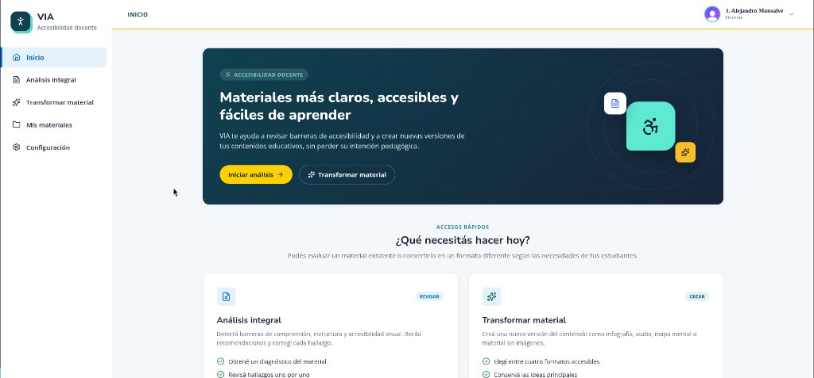
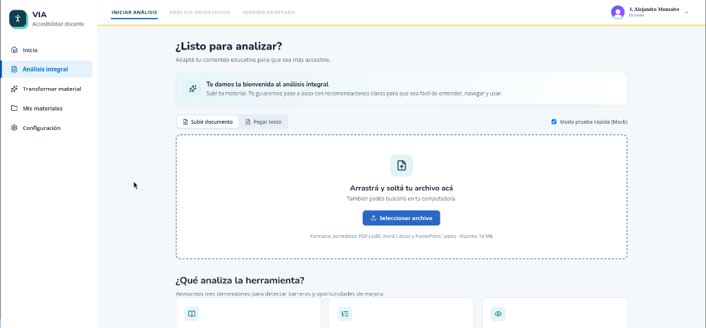
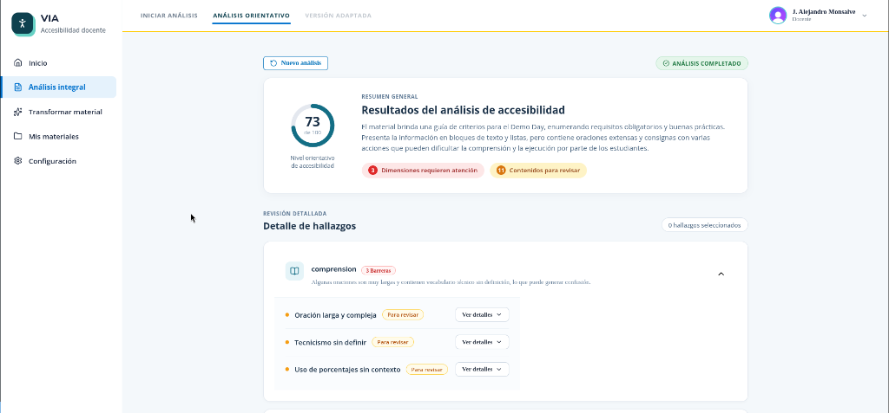
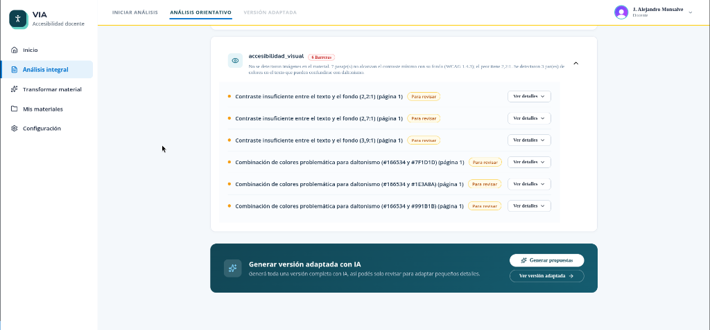
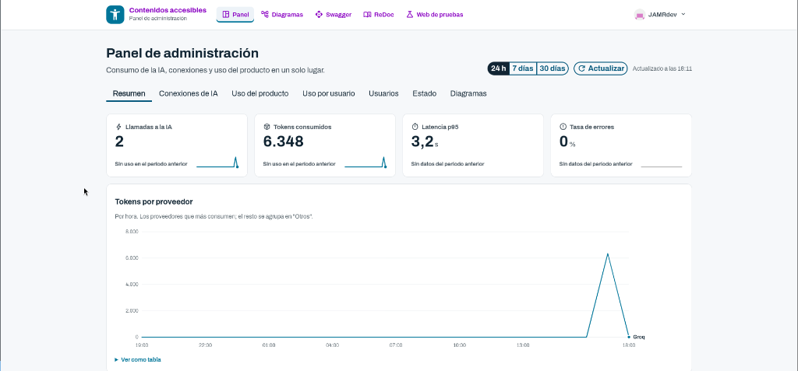
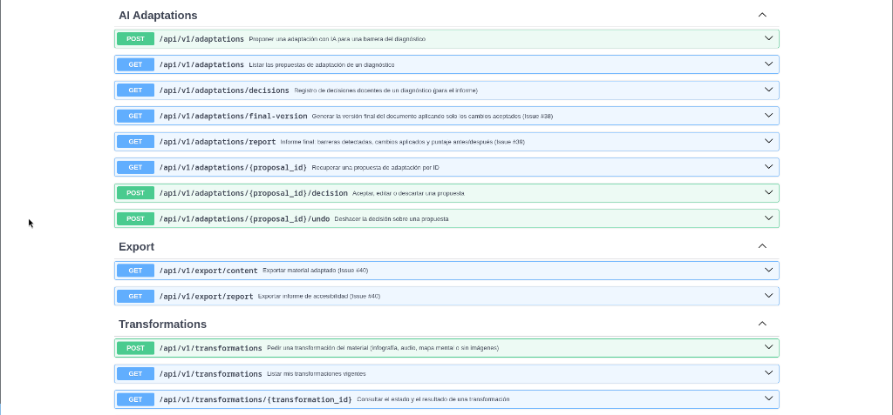
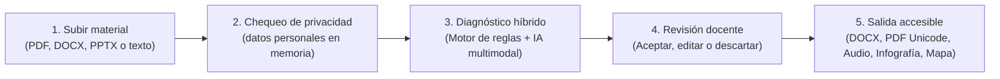
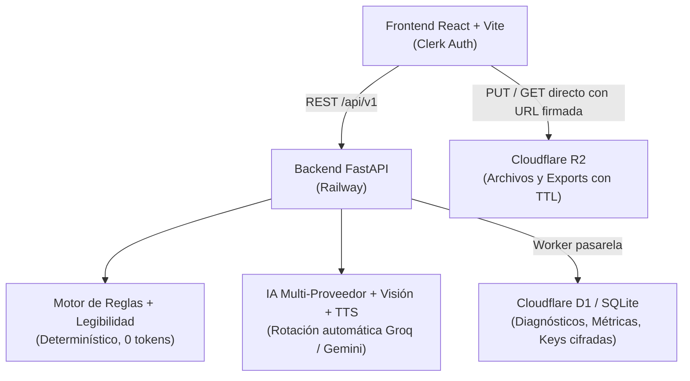

# VIA — Asistente de Accesibilidad Educativa (`contenidos_accesibles`)

Herramienta de Inteligencia Artificial y Diseño Universal para el Aprendizaje (DUA) orientada a docentes de nivel secundario y superior. Permite diagnosticar barreras de accesibilidad en materiales educativos (`.pdf`, `.docx`, `.pptx` o texto), generar propuestas de adaptación con control docente, exportar versiones accesibles y transformar contenidos a formatos alternativos.

---

## Funcionalidades principales

- **Diagnóstico híbrido (Reglas + IA):** evalúa **Comprensión**, **Estructura** y **Accesibilidad Visual** (oraciones extensas, consignas múltiples, legibilidad, letra chica, contraste WCAG, tipografía, solo color/daltonismo e imágenes sin texto alternativo).
- **Privacidad previa:** detecta datos personales antes de enviar texto a modelos externos y procesa los documentos en memoria.
- **Adaptación asistida:** el docente decide qué propuestas aceptar, editar o descartar, con recálculo de puntaje antes/después.
- **Exportación y transformaciones:** descarga en **Word (`.docx`)**, **PDF Unicode**, **Markdown** y **TXT**, además de transformaciones a **sin imágenes**, **mapa mental**, **audio narrado (TTS)** e **infografía accesible (SVG/PNG/PDF)**.

---

## Vista previa del producto

### 1. Acceso e Inicio docente
| Inicio de sesión con Clerk | Pantalla principal de VIA |
|---|---|
|  |  |

### 2. Carga de materiales y Diagnóstico integral
| Subida de archivo (`.pdf`, `.docx`, `.pptx` o texto) | Resultados: puntaje orientativo y barreras |
|---|---|
|  |  |

### 3. Accesibilidad visual (contraste y daltonismo) y Adaptación con IA


### 4. Operación y API
| Panel de administración (`/admin`) | Documentación interactiva (`/docs`) |
|---|---|
|  |  |

---

## Arquitectura y flujo

### Flujo de trabajo docente



### Arquitectura general



---

## Stack tecnológico

| Capa | Tecnologías |
|---|---|
| **Backend** | Python 3.12+, FastAPI, Uvicorn, Pydantic v2, PyMuPDF, `python-docx`, `python-pptx`, `fpdf2` |
| **Frontend** | React 19, TypeScript, Vite 5, Lucide Icons, Clerk (`@clerk/clerk-react`) |
| **IA / Multimodal** | Multi-proveedor con rotación automática (Groq, Gemini, OpenAI-compatibles) + Gemini TTS |
| **Persistencia y Storage** | SQLite (local) / Cloudflare D1 vía Worker (`backend/d1-gateway`) y almacenamiento local / Cloudflare R2 |
| **Tests** | `pytest`, `TestClient` (con modo `?mock=true` a 0 tokens) |

---

## Estructura del repositorio

```text
contenidos_accesibles/
├── backend/                 # API REST FastAPI, motor de reglas, servicios de IA y panel /admin
│   └── d1-gateway/          # Cloudflare Worker pasarela para D1 y configuración CORS de R2
├── frontend/                # Aplicación web React + Vite + TypeScript
├── tester/                  # Guías de QA y documentos de prueba (DocumentosDePrueba/)
└── README.md
```

---

## Requisitos previos

- **Python** 3.12 o superior
- **Node.js** 20+ y **npm**
- **Git**

---

## Instalación y ejecución paso a paso

### 1. Clonar el repositorio

```bash
git clone https://github.com/e18-innovalab/contenidos_accesibles.git
cd contenidos_accesibles
```

### 2. Levantar el Backend (`backend/`)

1. Crear y activar el entorno virtual:

   **Linux / macOS:**
   ```bash
   cd backend
   python3 -m venv venv
   source venv/bin/activate
   ```

   **Windows (PowerShell):**
   ```powershell
   cd backend
   python -m venv venv
   .\venv\Scripts\Activate.ps1
   ```

2. Instalar dependencias:
   ```bash
   pip install -r requirements.txt
   ```

3. Configurar variables de entorno:
   ```bash
   cp .env.example .env
   ```
   *(En Windows PowerShell: `Copy-Item .env.example .env`)*

   Generar una clave Fernet para `DB_ENCRYPTION_KEY`:
   ```bash
   python -c "from cryptography.fernet import Fernet; print(Fernet.generate_key().decode())"
   ```

   Completar como mínimo en `backend/.env`:
   - `ADMIN_PASSWORD`: contraseña para el panel `/admin`
   - `DB_ENCRYPTION_KEY`: clave generada en el paso anterior
   - `AI_API_KEY`: API key del proveedor principal (por defecto Groq; opcional si solo vas a probar con `?mock=true`)

4. Iniciar el servidor de desarrollo:
   ```bash
   uvicorn app.main:app --reload --port 8000
   ```
   - API: `http://localhost:8000`
   - Documentación Swagger: `http://localhost:8000/docs`
   - Panel de administración: `http://localhost:8000/admin`

> Para detalle completo de variables, Cloudflare D1/R2 y despliegue, ver [backend/README.md](backend/README.md).

### 3. Levantar el Frontend (`frontend/`)

En una nueva terminal desde la raíz del proyecto:

```bash
cd frontend
npm install
```

Verificar `frontend/.env.local` (si quieres apuntar a tu backend local en lugar del entorno de pruebas):

```env
VITE_API_URL=http://localhost:8000
VITE_CLERK_PUBLISHABLE_KEY=<tu_clerk_publishable_key>
```

Iniciar el servidor de desarrollo:

```bash
npm run dev
```

- Aplicación web: `http://localhost:5173`

---

## Tests del Backend

Desde `backend/` con el entorno virtual activo:

```bash
pytest
```

> **Nota:** Si tu sistema define la variable `DEBUG=release` (común en algunos entornos/IDEs), ejecutá `env -u DEBUG pytest` en Linux/macOS para que Pydantic no falle al parsear `DEBUG` como booleano.
